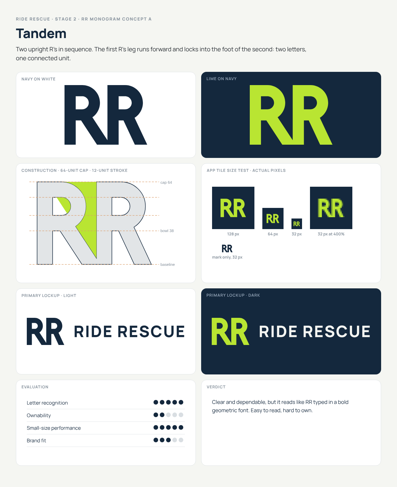
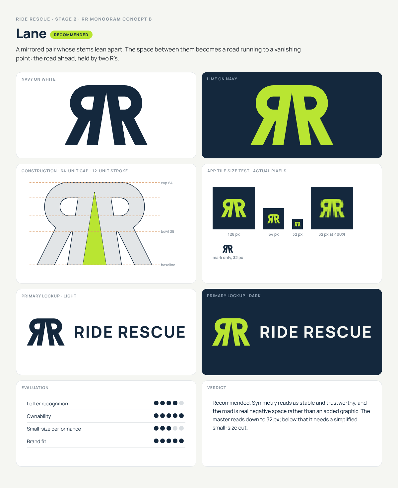
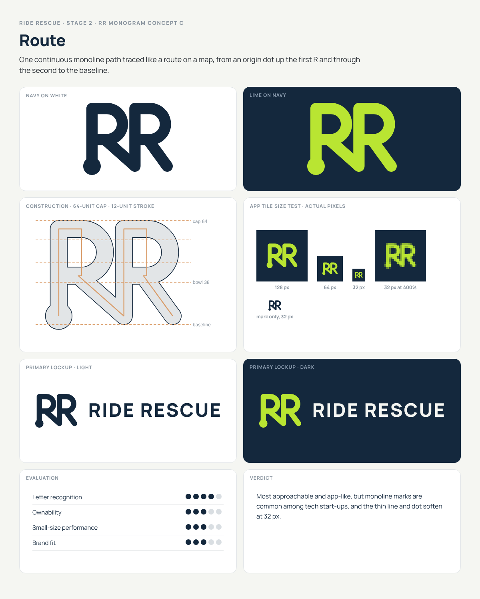

# Ride Rescue — Stage 2: RR Monogram Concepts

> **Superseded:** Lane was approved, then replaced by identity v2 (industrial italic RR, gear and peaks). See `03-identity-system.md`. Lane is archived in `archive/lane-v1/`.

All three concepts share one construction system, so whichever is chosen, the rest of the identity inherits the same grid:

- **Cap height:** 64 units. **Master stroke:** 12 units (H ÷ 5.33). **Bowl height:** 38 units.
- Bowls are true semicircles joined to straight bars. Diagonal legs keep a true *perpendicular* thickness of 12, not a horizontal one, so they don't look thinner than the stems.
- Each mark is boolean-unioned into **one compound path**: no strokes, no overlaps, no transforms. B (Lane) is 3 contours in total.

Boards: `exploration/stage-2/board-*.png`, or all four pages in `exploration/stage-2/ride-rescue-stage-2-monogram-concepts.pdf`.
Size tests at 1024, 512, 128, 64 and 32 px: `exploration/stage-2/png/`.

---

## A · Tandem

- **Idea:** two letters, one connected unit, standing for customer and technician linked.
- **Construction:** two identical upright geometric R's on a 46-unit pitch. The first R's leg runs forward at about 33° and lands on the foot of the second R's stem, fusing the pair at the baseline.
- **Negative space:** an 8-unit vertical channel between the first bowl and the second stem opens into a closed triangular counter above the shared foot.
- **Impression:** solid, dependable, conventional.
- **Fit:** the most legible option and the safest. It's also the least ownable: it reads like "RR" typed in a bold geometric font, and a competitor could arrive at it by accident.
- **Small sizes:** best of the three. Counters stay open at 32 px.
- **With the wordmark:** sits naturally beside Manrope, perhaps too naturally. The mark and type feel like the same font, so the mark adds little recognition of its own.

## B · Lane (recommended)

> **Revised in Stage 3:** the road now runs through the cap line and fully divides the two R's, rather than closing 7.5 units below the top. See `03-identity-system.md`. This section describes the concept as first presented.

- **Idea:** the road ahead. Two R's stand back to back. Their stems lean apart, and the space between them becomes a road running to a vanishing point.
- **Construction:** a mirrored pair (Я | R) on a shared centre axis. The stems' inner edges run from −1.2 units at the cap line to 9 units at the baseline, so the stems fuse for the top 7.5 units. That gives one solid silhouette with no fragile touching point, which matters for vinyl cutting and embroidery. The bowls are identical to A's, and the legs kick outward at about 27°.
- **Negative space:** a single tapered triangle, 18 units wide at the baseline and closing to a point near the cap line. It is a road in perspective. Nothing is drawn on it, so there are no lane dashes and no arrows.
- **Impression:** stable and symmetrical like a badge or emblem, with forward momentum from the converging road. Calm, not frantic.
- **Fit:** it is the one concept whose idea is in the letterforms rather than added on. "Rescue" is implied without a cross, wrench or hook.
- **Small sizes:** the road is a clear notch at 64 px. At 32 px it still reads, but softly. At 24 px it is barely there, and at 16 px it disappears and the counters close (see `png/b-lane-small-size-16-24-32-at-1000pct.png`). The master mark is therefore good down to 32 px. A dedicated small-size cut is required for favicons and 16–24 px UI: lane widened, counters enlarged, mark filling about 80% of the tile instead of 60%. That is a Stage 4 deliverable, and the brief's "simplified small-size logo" exists for exactly this case.
- **With the wordmark:** the lockup puts a symmetrical emblem beside a left-to-right wordmark, which separates mark and type more clearly than A. The mark is wide (1.43:1), so it holds its own at the left of a horizontal lockup and centres well above a stacked one.
- **Known risk:** the first R is mirrored. In a logo context most readers parse a mirrored pair as "RR" (it's an established monogram convention), but some will see "ЯR". The mitigation is to always show the wordmark in primary uses; the mark stands alone only where recognition is already built, such as the app icon, favicon and uniforms.

## C · Route

- **Idea:** a route traced on a map. One continuous monoline runs from a solid origin dot, up the first stem, around the bowl, down the leg straight into the second R, and ends on the baseline.
- **Construction:** a 10.5-unit monoline with round caps and joins, built from capsules and half-rings. The bowls match A and B in proportion.
- **Negative space:** the open V where the first leg meets the second stem. The route itself is the idea, not the space around it.
- **Impression:** friendly, digital, app-first.
- **Fit:** the most approachable and the closest to "technology platform", but monoline marks are now common among tech start-ups, and the rounded line softens the "strong" side of the personality.
- **Small sizes:** weakest. The thinner line and the origin dot blur at 32 px, and the dot can read as a stray full stop.
- **With the wordmark:** the round terminals clash slightly with Manrope 800's flat terminals. It would need a rounder wordmark face to feel coherent.

---

## Scorecard

| | A · Tandem | **B · Lane** | C · Route |
|---|---|---|---|
| Letter recognition | ●●●●● | ●●●●○ | ●●●●○ |
| Ownability | ●●○○○ | **●●●●●** | ●●●○○ |
| Small-size performance | ●●●●● | ●●●○○ | ●●●○○ |
| Brand fit (stable, modern, calm) | ●●●○○ | **●●●●●** | ●●●○○ |

## Recommendation: B · Lane

Lane is the only concept whose idea lives in the letterforms rather than being added to them. Its symmetry carries the trust and stability the brief asks for, and the converging road gives it forward motion without italics or speed lines. It trades a small amount of letter recognition, from the mirrored first R, for a large gain in ownability. That trade is managed by pairing it with the wordmark wherever recognition matters.

If strict letter recognition is non-negotiable, A (Tandem) is the fallback. It is cleaner to read but much harder to own.

## What Stage 3 will refine on the chosen mark

- Optical overshoot on the bowls (about 1 unit) so they don't look smaller than the flat tops.
- An ink-trap check where the stems fuse at the apex, at 32 px and in embroidery.
- The small-size cut (16–24 px) with a widened lane and larger counters.
- Lockup spacing, clear space and minimum sizes, defined in mark units.
- Wordmark customisation: test opening the R in RIDE and RESCUE to match the monogram's bowl geometry.
